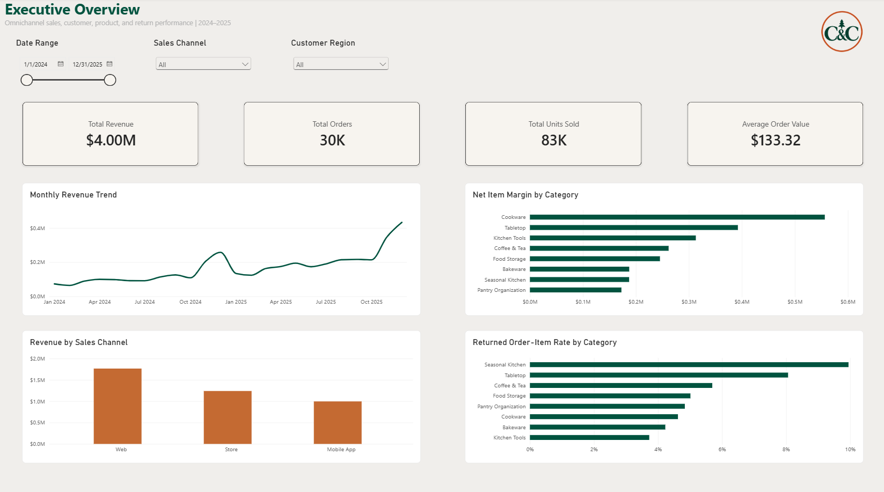
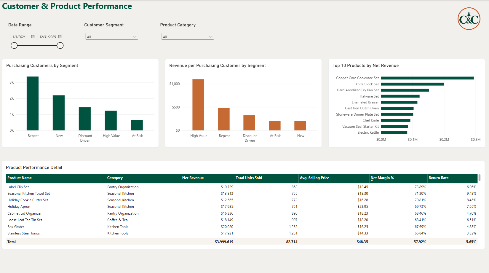

# Cedar & Copper Omnichannel Analytics

## Project Overview

Cedar & Copper is a fictional omnichannel kitchenware retailer operating through web, mobile-app, and physical-store channels. This end-to-end business intelligence case study evaluates sales, customer, product, profitability, and return performance across 2024 and 2025.

The project demonstrates a business-facing analytics workflow: defining the problem, establishing KPIs, analyzing data with SQL, validating results, building an interactive Power BI report, and translating the findings into practical recommendations.

## Business Problem

Cedar & Copper’s leadership needs a consistent view of business performance across sales channels, customer segments, and product categories.

The analysis addresses the following questions:

- How are revenue, order volume, units sold, and average order value performing?
- Which channels and product categories contribute the most revenue and margin?
- Which customer segments generate the greatest value?
- Which products lead in revenue, unit sales, and average selling price?
- Where do elevated return rates indicate potential product or fulfillment issues?
- What actions should leadership prioritize based on the results?

## Tools

- **SQLite and SQL** for querying, aggregation, reconciliation, and validation
- **Power BI** for data modeling, DAX measures, interactive analysis, and dashboard design
- **Power Query** for data-type preparation
- **Markdown** for project and KPI documentation

## Data and Model

The project uses a synthetic retail dataset covering January 2024 through December 2025.

### Source tables

- `customers`
- `orders`
- `order_items`
- `products`
- `returns`
- `stores`
- `marketing_campaigns`

The Power BI model connects customer, order, order-item, product, return, and store data through validated one-to-many relationships. Reporting measures are calculated at the appropriate business grain to prevent duplicated revenue, order, customer, or return counts.

The principal analytical grains are:

- One row per customer
- One row per order
- One row per order-item line
- One row per product
- One row per return record

## Analytical Approach

1. Defined the business problem and project scope.
2. Reviewed the database structure and established reporting grains.
3. Created a KPI dictionary with definitions, calculations, sources, filters, and limitations.
4. Used SQL to analyze customer and product performance.
5. Built and validated Power BI measures against SQL and database baselines.
6. Created two interactive Power BI report pages.
7. Performed data-quality checks covering keys, duplicates, missing values, orphaned records, revenue reconciliation, and return data.
8. Developed findings and recommendations for business leadership.

## Core KPIs

| KPI | Definition |
|---|---|
| Total Revenue | Sum of net order revenue before return adjustments |
| Total Orders | Distinct count of orders |
| Total Units Sold | Sum of order-item quantities |
| Average Order Value | Total revenue divided by total orders |
| Purchasing Customers | Distinct customers with at least one order |
| Revenue per Purchasing Customer | Total revenue divided by purchasing customers |
| Average Selling Price | Net item revenue divided by units sold |
| Net Item Margin | Net item revenue less item cost |
| Net Item Margin Percentage | Net item margin divided by net item revenue |
| Returned Order-Item Rate | Returned order-item lines divided by total order-item lines |
| Orders per Customer | Distinct orders divided by purchasing customers |
| Customer Segment Percentage | Customers in a segment divided by all customers |

Validated portfolio baselines include:

- **Total Revenue:** $3,999,618.75
- **Total Orders:** 30,000
- **Total Units Sold:** 82,714
- **Average Order Value:** $133.32
- **Returned Order-Item Rate:** 5.65%
- **Net Item Margin Percentage:** 57.92%

## Power BI Dashboard

### Executive Overview

The Executive Overview presents company-level KPIs, monthly revenue, sales-channel performance, category margin, and returned order-item rates. Leadership can filter the page by date, sales channel, and customer region.



### Customer & Product Performance

The second page compares customer-segment value and product performance. It includes purchasing customers, revenue per purchasing customer, the top products by net revenue, and detailed product metrics.



## Key Findings

- Total revenue reached approximately **$4.00 million** across **30,000 orders** and **82,714 units**, with an average order value of **$133.32**.
- Web was the largest sales channel by revenue.
- Cookware generated the most category revenue at approximately **$1.04 million**.
- Cookware and Tabletop together accounted for approximately **43% of product revenue**.
- The Copper Core Cookware Set was the highest-revenue product at approximately **$294,000** and had the highest average selling price at **$239.02** per unit.
- Repeat customers generated the most total revenue and orders.
- High Value customers produced the highest average order value, orders per customer, and revenue per purchasing customer.
- The top 10 customers by revenue were all classified as High Value.
- Seasonal Kitchen produced the fewest units and category orders while also showing the highest category-level returned order-item rate.
- The Entertaining Cheese Board had the highest product-level returned order-item rate at **12.7%**, with 81 returned lines out of 638 order-item lines.
- Revenue and unit volume tell different stories: several high-volume products generated substantially less revenue than premium products.

## Business Recommendations

1. **Protect high-value customer relationships.** Develop retention and personalized engagement strategies for High Value customers because they produce the strongest per-customer economics.

2. **Convert more new customers into repeat purchasers.** Review the customer journey following the first purchase and test targeted follow-up offers, replenishment reminders, and product recommendations.

3. **Investigate Seasonal Kitchen returns.** Review return reasons, product descriptions, packaging, fulfillment processes, and supplier quality before increasing investment in this category.

4. **Prioritize profitable category growth.** Maintain strong visibility and inventory support for Cookware and Tabletop while monitoring margin, stock availability, and discounting.

5. **Evaluate products using multiple measures.** Use revenue, unit volume, average selling price, margin, and return rate together rather than treating sales volume as the sole indicator of success.

6. **Monitor channel performance and customer mix.** Use the dashboard filters to determine whether channel growth is attracting valuable repeat customers and producing sustainable margin.

## Data Quality and Validation

Validation included:

- Source-table row counts
- Primary-key uniqueness
- Duplicate-record checks
- Missing-value checks
- Orphaned foreign-key checks
- Order and order-item revenue reconciliation
- Return-record validation
- SQL-to-Power BI KPI reconciliation
- Default-filter and slicer testing

The core KPI totals in Power BI were reconciled to the database before the report was finalized.

## Important Limitations

- The dataset is synthetic and should not be interpreted as actual company performance.
- The mock data is more evenly structured than a typical retail dataset, including exactly 10 products in each category.
- Revenue is reported before refund adjustments; returns are analyzed separately.
- The returns table does not contain returned quantity. The return metric therefore measures the percentage of order-item lines associated with a return record, not the percentage of individual units returned.
- Return reasons are unavailable, so elevated return rates identify areas for investigation rather than proving a specific cause.
- Customer segments are supplied by the dataset and were not independently modeled in this project.
- Apparent trends, seasonality, and outliers may reflect the synthetic data-generation process.

## Repository Structure

```text
cedar_copper/
├── README.md
├── data/
│   ├── cedar_copper.db
│   └── source CSV files
├── documentation/
│   ├── project brief
│   ├── KPI dictionary
│   ├── data quality and validation
│   └── findings and recommendations
├── powerbi/
│   └── cedar_copper_analysis.pbix
├── screenshots/
│   ├── 01_executive_overview.png
│   └── 02_customer_product_performance.png
└── sql/
    ├── 01_customer_analysis.sql
    └── 02_product_analysis.sql